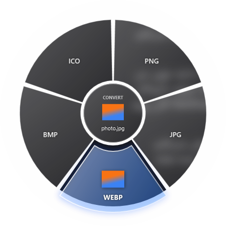

# FanDrop

**English** | [فارسی](README.fa.md)

Drag a file, hold a key, drop it on a wedge — done.
FanDrop is a tiny Windows tray app that shows a radial "fan" of quick actions under your cursor while you drag a file from Explorer. Convert, compress, resize, zip or recycle files without opening another program.


<!-- Add a screenshot at docs/screenshots/fan.png -->

## Features

| Hold while dragging | Fan | Examples |
|---|---|---|
| **Shift** | Convert | Image → PNG / JPG / WEBP / BMP / ICO · Video → MP4 / MOV / WEBM / GIF / MP3 · Audio → MP3 / M4A / WAV / FLAC / OGG |
| **Ctrl** | Actions | Resize, compress, rotate, grayscale, strip metadata · Mute, trim 30s, extract frame · Normalize, mono |
| **Alt** | Tools | Copy path, ZIP, reveal in Explorer, open, send to Recycle Bin |

- Frosted-glass fan with live file thumbnails
- Works with multiple files at once
- Results are saved to `Downloads\FanDrop` and revealed in Explorer
- Never overwrites — duplicates get a number suffix
- Lives in the system tray, optional start with Windows

## Install

1. Download **`FanDrop-Setup.exe`** from the [latest release](https://github.com/Alireza-Fakhari/fandrop/releases/latest).
2. Run it (no admin rights needed). FFmpeg is bundled with the installer.
3. FanDrop starts in the tray (bottom-right of the taskbar).

> Windows SmartScreen may warn because the installer isn't code-signed. Click **More info → Run anyway**.

## Usage

1. Start dragging any file in Explorer.
2. While dragging, hold **Shift**, **Ctrl** or **Alt** — the fan appears under the cursor.
3. Move onto a wedge and release the mouse.
4. The result opens in `Downloads\FanDrop`.

Right-click the tray icon for **How to use**, **Open output folder**, **Open log** and **Quit**.

## Requirements

- Windows 10 or 11 (x64)
- FFmpeg for media conversion (bundled in the installer; when building from source install it with `winget install Gyan.FFmpeg`)

## Build from source

```bash
git clone https://github.com/Alireza-Fakhari/fandrop.git
cd fandrop/FanDropWin
dotnet run -c Release
```

Requires the [.NET 8 SDK](https://dotnet.microsoft.com/download/dotnet/8.0). See [CONTRIBUTING.md](CONTRIBUTING.md) for publishing and building the installer.

## Contributing

Issues and pull requests are welcome — see [CONTRIBUTING.md](CONTRIBUTING.md).

## License

[MIT](LICENSE) © Alireza Fakhari.
The installer bundles [FFmpeg](https://ffmpeg.org/), which is licensed separately under the LGPL/GPL.
